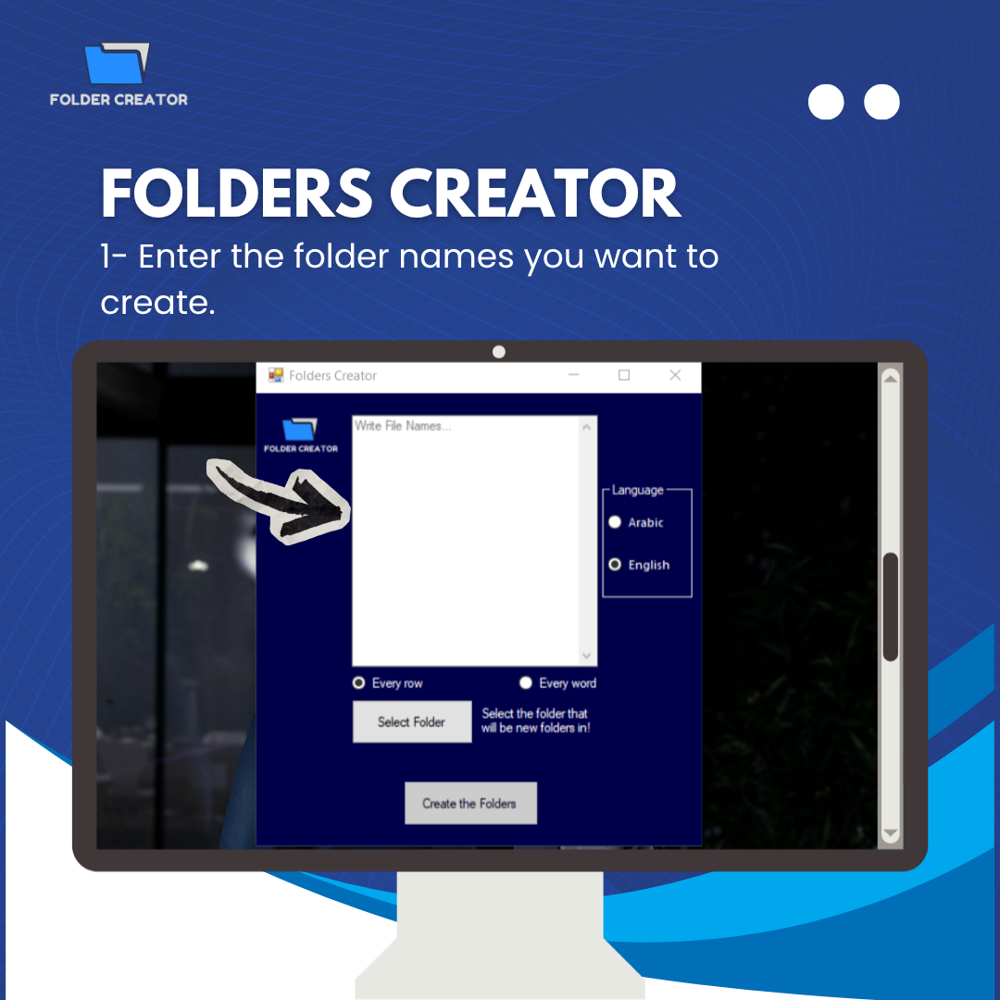
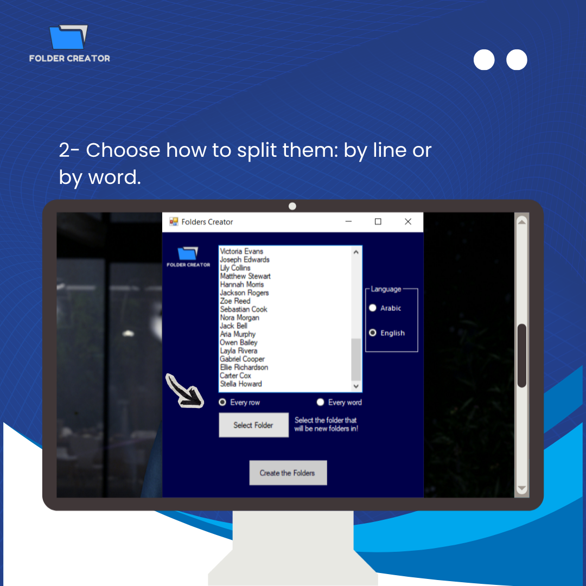
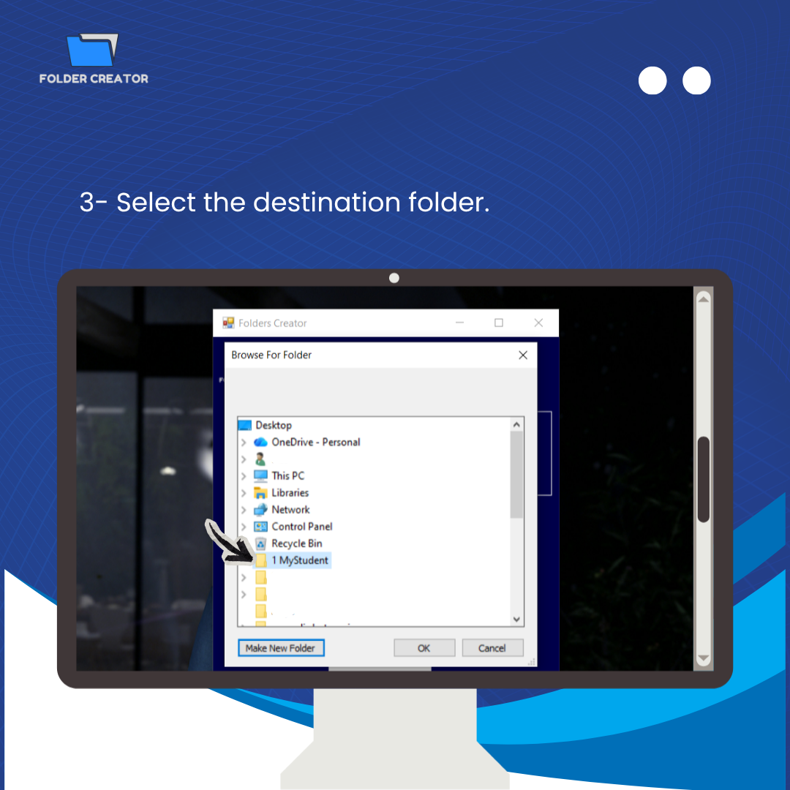
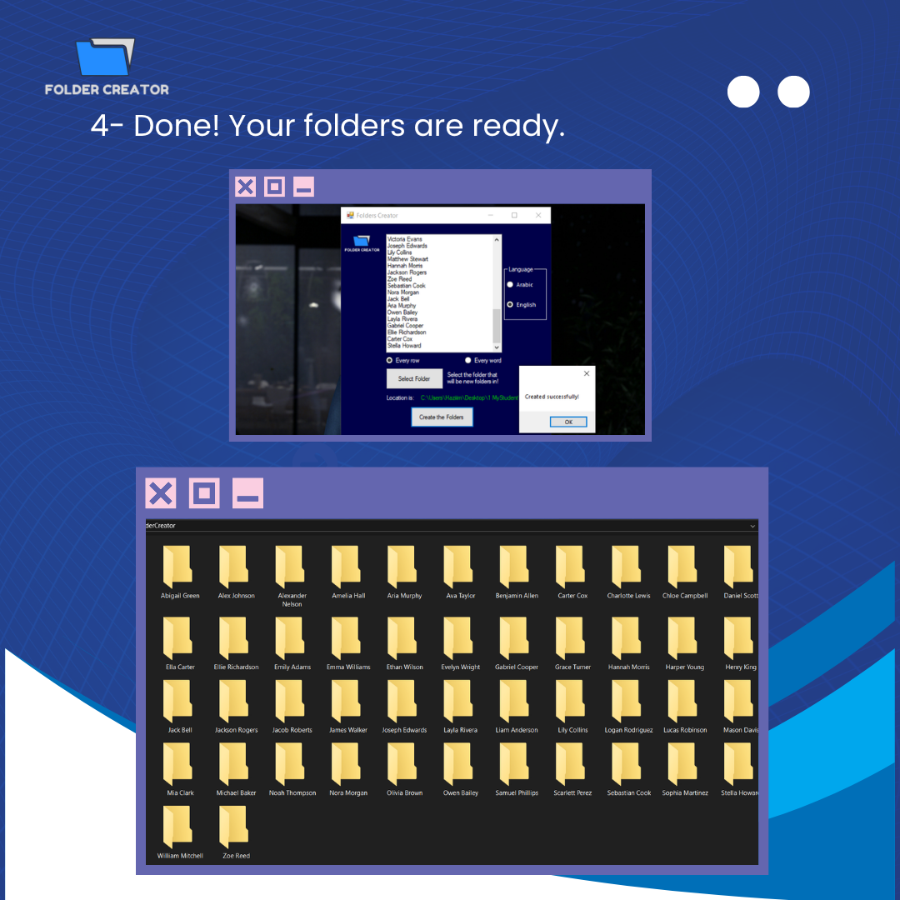

# 📁 Folder Creator

A simple Windows app that creates many folders at once from a list of names.

## How to Use Folder Creator

**1. Enter the folder names you want to create.**

**2. Choose how to split them: by line or by word.**

- **Every row** → each line becomes one folder
- **Every word** → each word becomes one folder

**3. Select the destination folder.**

Click **Select Folder**, choose a location, then click **Create the Folders**.

**4. Done! Your folders are ready.**

Your new folders are created inside a `FolderCreator` folder in the location you selected.

## Features

- Create many folders in one click
- Split names by line or by word
- English and Arabic (right-to-left) input support

## Requirements

- Windows
- .NET Framework 4.8

## Run

Download or clone the project, open `CreateFoldersByNames.sln` in Visual Studio, and press **Start** — or run `bin/Debug/CreateFoldersByNames.exe` directly.
